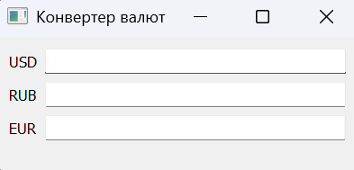
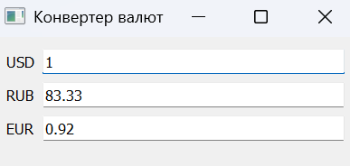
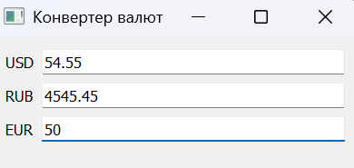

# Аникин Арсений 6233-010302D
# Лабораторная работа №2.

## Задание

Реализовать приложение с полями для ввода суммы в долларах США, рублях и евро. При изменении суммы в одном поле автоматически пересчитываются значения в остальных валютах.

## Реализация

### main.py

Опишем основные используемые методы:
1. **Currency.convert(text, source)** - преобразует введённую сумму в число, учитывает запятую как десятичный разделитель и рассчитывает эквивалент во всех валютах
2. **CurrencyCalc.__init__()** - настраивает окно, создаёт поля ввода с проверкой формата числа и связывает их события с обработчиком и калькулятором
3. **update_fields(source, values)** - отображает рассчитанные суммы в полях валют

Курс валют захардкожен в классе Currency в списке rates.

Окно с полями ввода:

Изменение значений при вводе:

### cl1.py

**CurrencyInput.on_text_edited(currency, text)** - отправляет сигнал conversionRequested с кодом валюты и введённым значением.

### cl2.py

**convert(source_currency, text)** — вызывает расчёт конвертации и отправляет результат через сигнал conversionReady.
