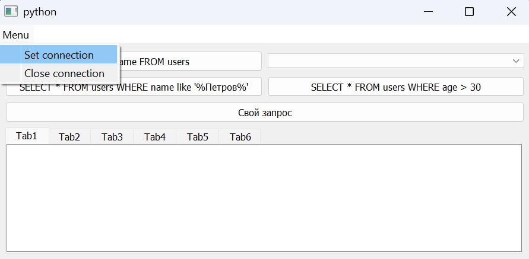
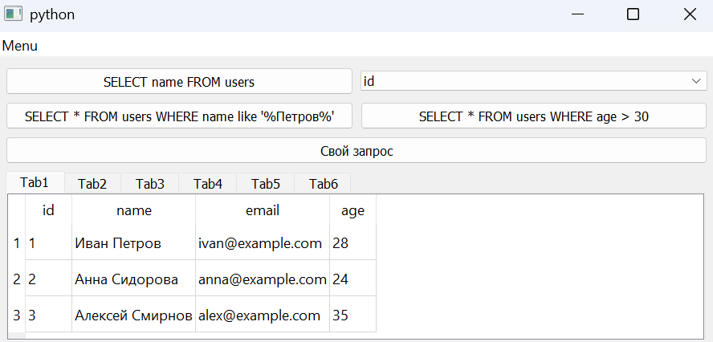
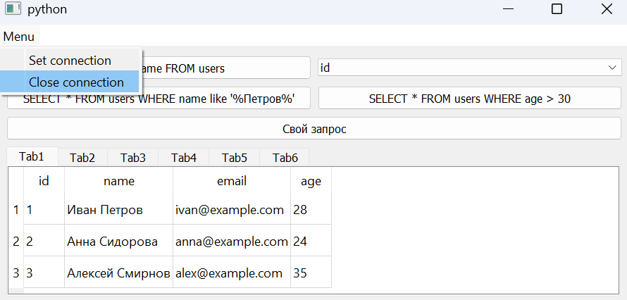
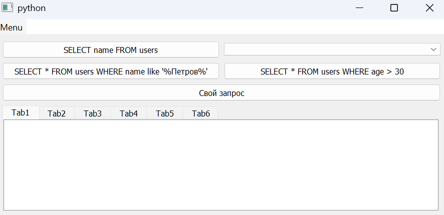
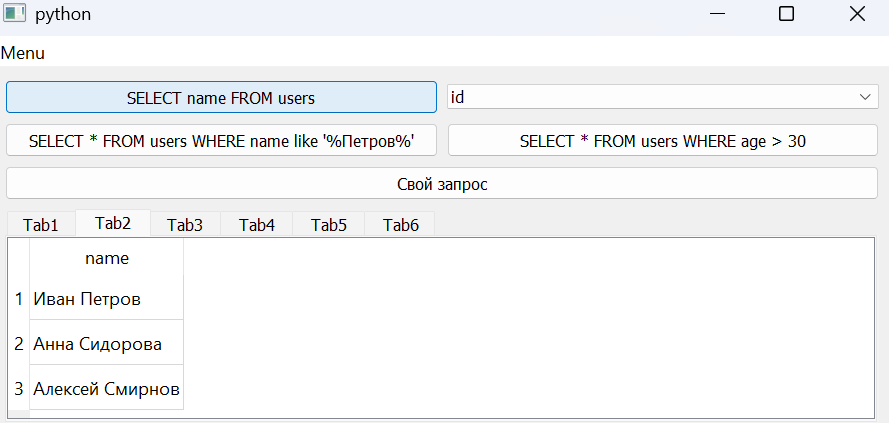
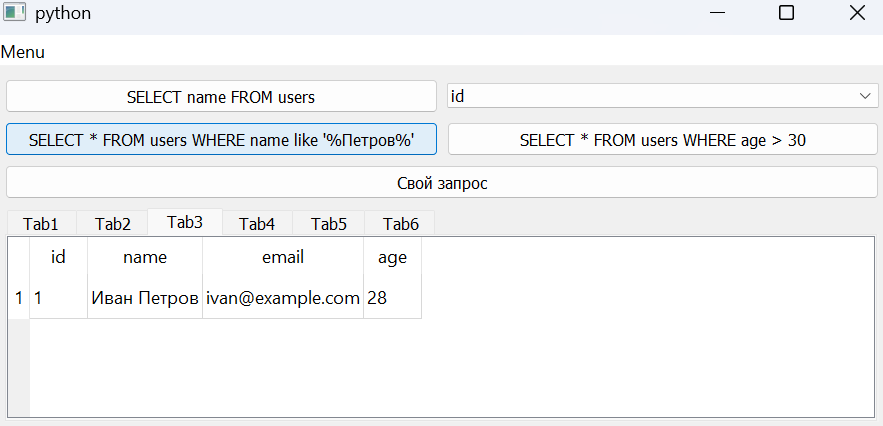
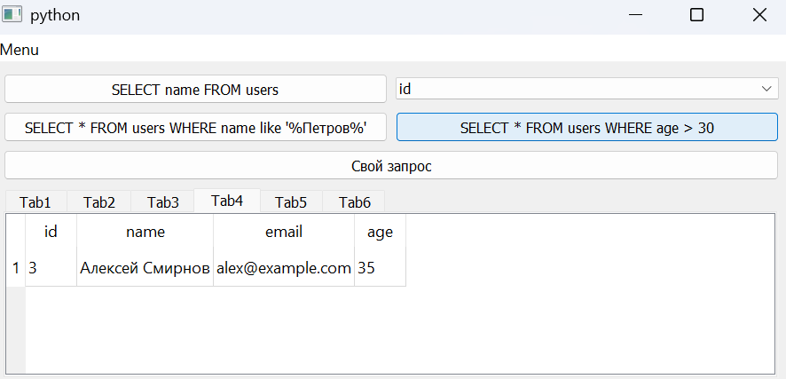
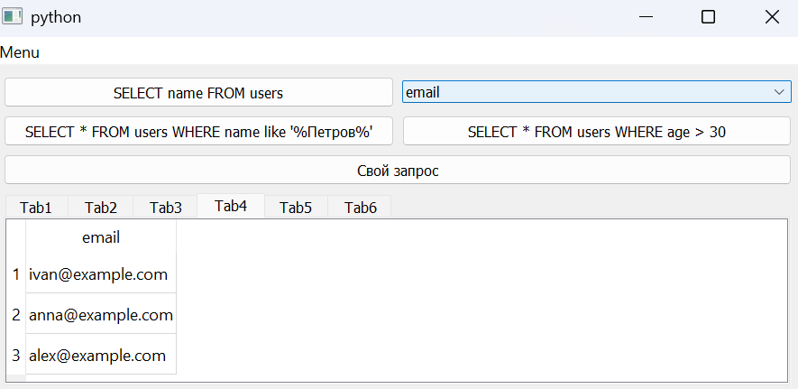
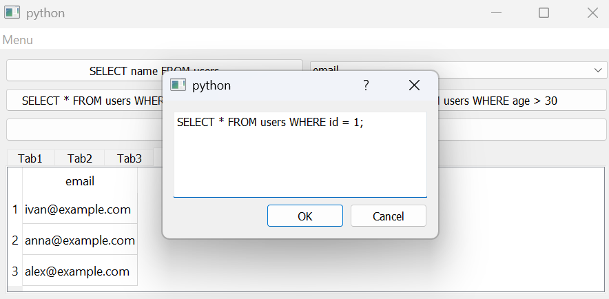
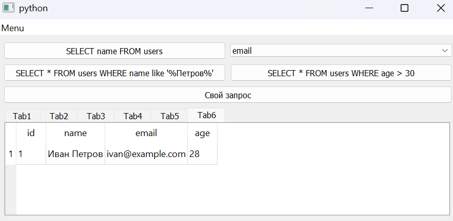

# Аникин Арсений 6233-010302D
# Лабораторная работа №3.

## Задание

Реализовать приложение на PyQt с использованием представления таблиц и работы с SQL.

## Реализация

В качестве примера используется простейшая БД users

1. Set connection

Вызывает стандартное диалоговое окно выбора файла базы данных QFileDialog, инициализирует и открывает подключение к SQLite, загружает в первую вкладку результаты запроса `SELECT * FROM users`

2. Close connection

Очищает и уничтожает объекты моделей из памяти, очищает выпадающий список колонок, закрывает соединение QSqlDatabase и удаляет его

3. Кнопки с запросами

Выполняют предустановленные заданные SQL-запросы с выводом результатов на фиксированные вкладки 

`SELECT name FROM users` -> вкладка 2

`SELECT * FROM users WHERE name like '%Петров%'` -> вкладка 3

`SELECT * FROM users WHERE age > 30` -> вкладка 4

4. Запросы по столбцам

срабатывает при выборе элемента в выпадающем списке колонок. Считывает имя выбранного столбца, подставляет его в строковый шаблон `SELECT "{colum_name}" FROM users` и выводит выборку данных на вкладку 4

5. Кастомный запрос

открывается модальное диалоговое окно QueryDialog и, после ввода и подтверждения  - нажатие "ОК", отправляет кастомный SQL-запрос, результат которого отображается на вкладке 6.

