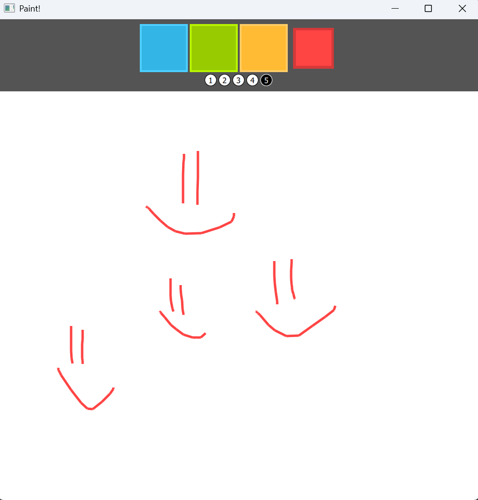
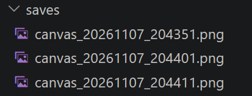
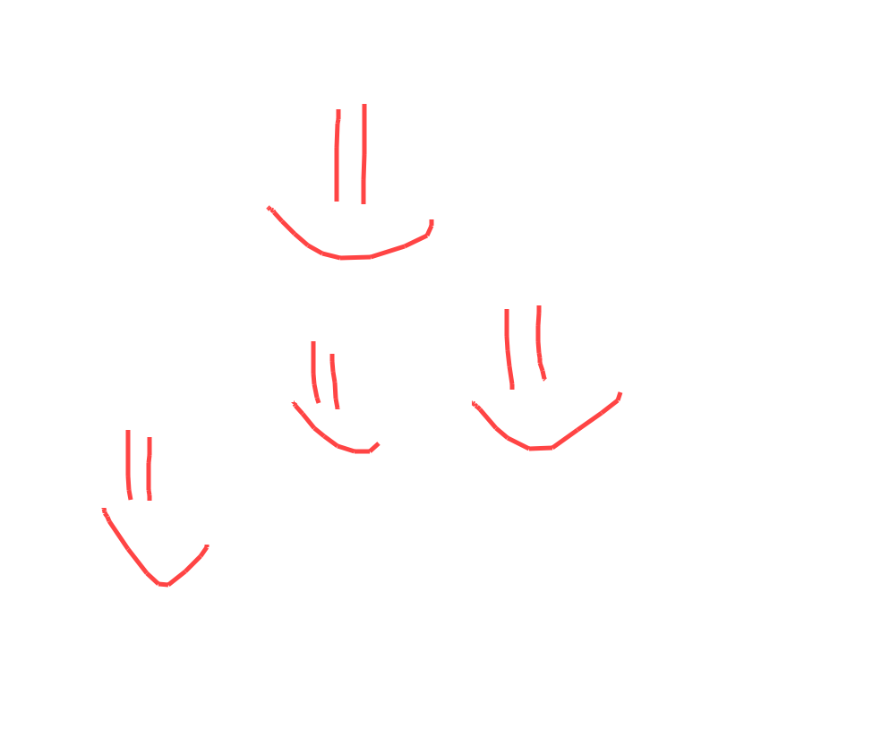

# Аникин Арсений 6233-010302D
# Лабораторная работа №4.

## Задание

В классе Inerface реализовать логику сохранения области рисования canvas по таймеру на носитель информации в файл

## Реализация

* Для таймера используем QTimer, который с заданным интервалом запускает сохранение.

* С помощью механизмов рефлексии Qt (findChildren) находим объект Canvas в дереве элементов QML и считывает его текущие координаты и размеры.

* Через QScreen.grabWindow делаем снимок всего окна по его winId, после чего изображение по границам холста.

* Сохраняем в папку папку saves с именем на основе текущего времени.

## Результаты

## Сами сохранённые canvas

